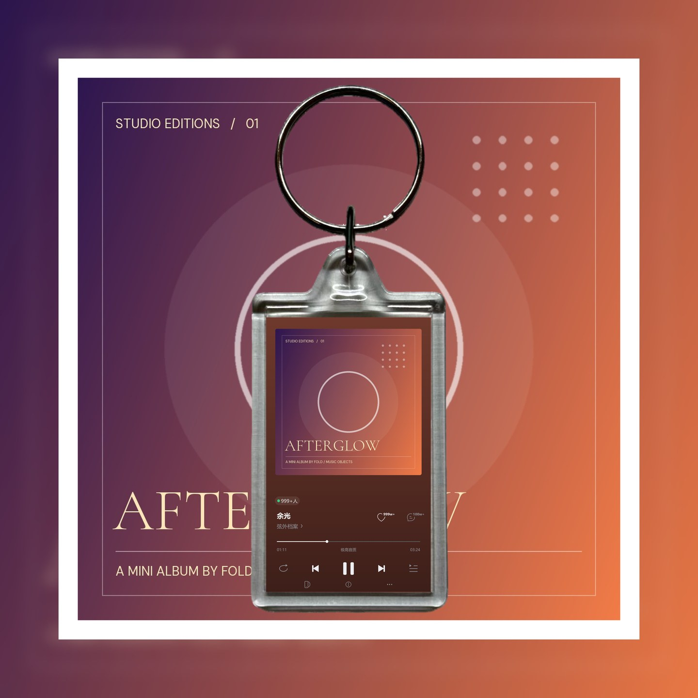
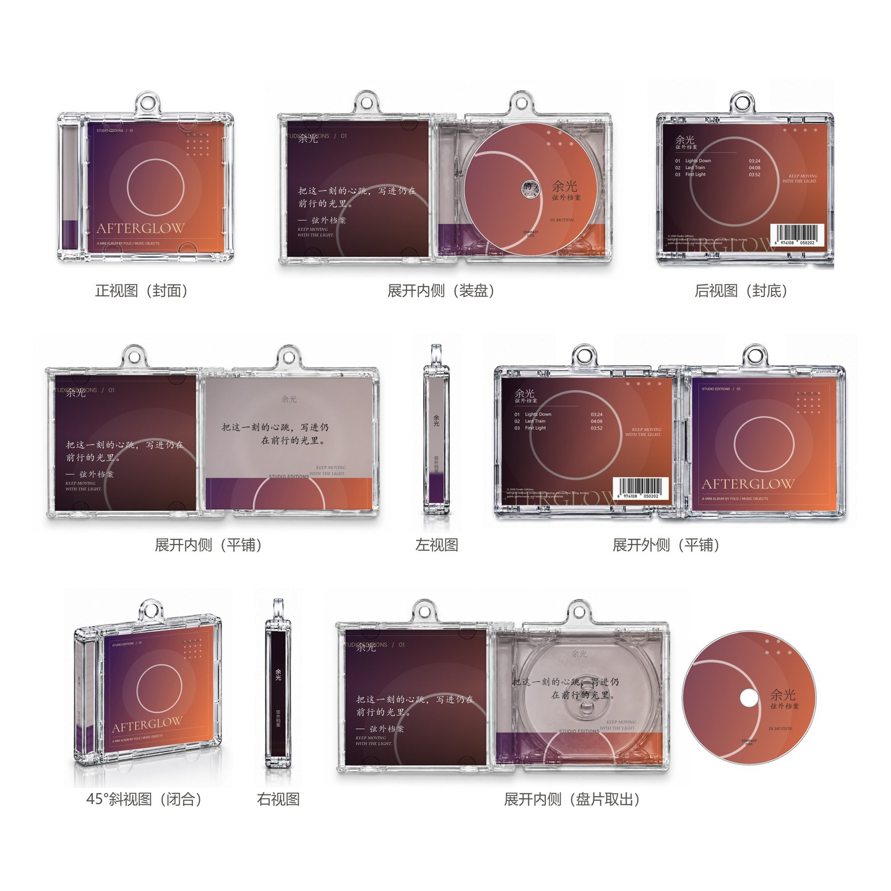
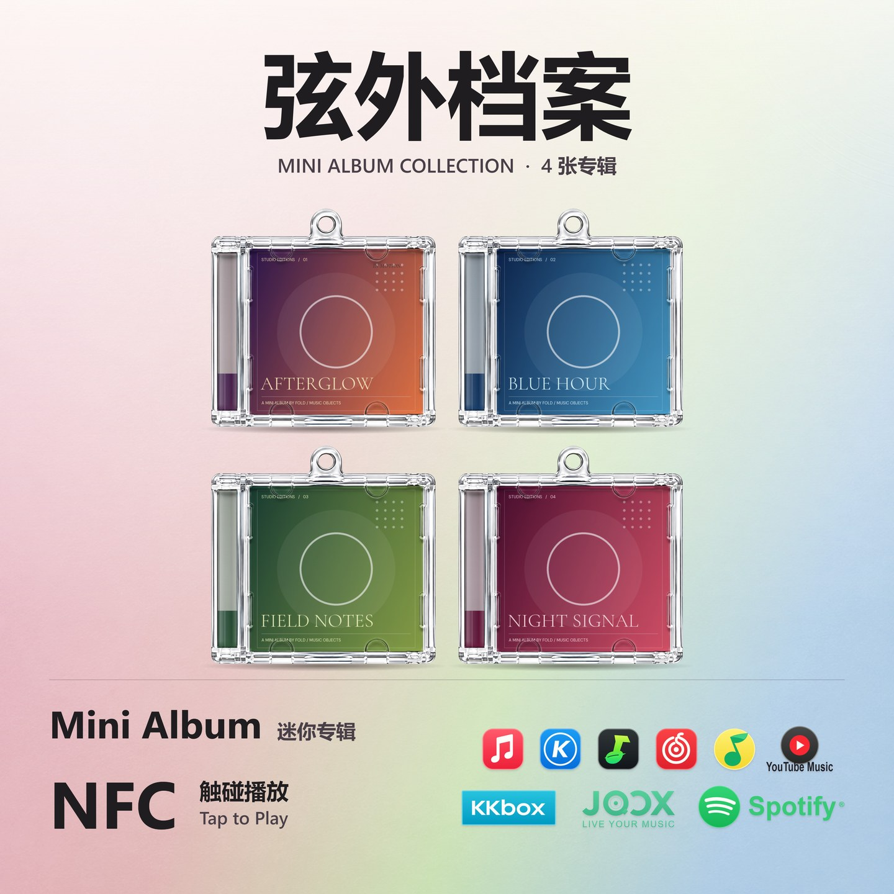

# 拾音工坊 · 音乐周边制作

从歌曲或专辑封面制作钥匙扣商品图、迷你 CD 样机和可直接打印的 A4 拼版。工作台在本机运行，作品也保存在本机。

| 钥匙扣商品图 | 迷你 CD 九视图 | 批量专辑海报 |
| --- | --- | --- |
| [](assets/demo/readme-keychain.jpg) | [](assets/demo/readme-nine-views.jpg) | [](assets/demo/readme-batch-poster.jpg) |

以上是用原创演示封面生成的成品预览，点击可放大。

## 能制作什么

| 从哪里开始 | 能得到什么 |
| --- | --- |
| 搜索歌曲，或在歌手主页选择热门歌曲 | 钥匙扣场景图、电商白底或透明底版式、黑胶播放图，以及 30 × 50 mm 播放卡和对折卡。钥匙扣有长条透明款和透明方形圆环款。 |
| 在歌手主页打开专辑，点击「设计并打印」 | 迷你 CD 的盘面、封面折件和封底条，可继续调整各个部件。导出封面商品图、三视图和九视图总览、九张独立样机图、内外展开组合图，以及印刷文件。 |
| 在「专辑」页勾选多张，点击「批量制作」 | 批量生成各专辑的商品图和印刷文件，再按封面色调生成合集海报。每张海报最多排 8 张专辑，超过后自动分页。 |
| 打开「作品库」 | 回看已经完成的作品、下载 ZIP，或将选中的作品移入回收站。 |

搜索支持歌手、单曲与专辑，工作台会使用网易云音乐与 QQ 音乐补全数据。歌曲和迷你 CD 商品图可加文字或图片水印。

## 导出和打印

- **商品图**以高清 JPEG 下载。迷你 CD 样机和专辑海报为 **4096 × 4096 px**，钥匙扣等歌曲商品图的最长边上限为 **4096 px**。JPEG 下载时，透明区域会合成白底。
- **歌曲打印文件**按 A4 实际尺寸、600 DPI 导出，播放卡成品为 **30 × 50 mm**。默认每页 32 张，也可选择直排 30 张、留缝 21 张或对折卡。每首歌曲的 A4 播放卡拼版提供 JPG 和 PDF。
- **迷你 CD 打印文件**提供 1:1 版面总览和 A4 拼版 PNG／PDF。默认是竖版每页 7 套封面折件和封底条，也有横版。A4 拼版为 600 DPI，竖版 PNG 实际为 **4961 × 7016 px**。
- 打印时选 **100%／实际大小**。迷你 CD 拼版先量一下 50 mm 校验尺，再批量裁切。

## 快速开始

### Windows

先安装 Git 和 Python 3.10+。安装 Python 时勾选 **Add Python to PATH**。 [Git for Windows 下载](https://git-scm.com/download/win)

打开 PowerShell，进入希望存放项目的目录，运行下面的命令。

```powershell
git clone https://github.com/zjhvffjk/music-merch-studio.git
cd music-merch-studio
python -m venv .venv
.\.venv\Scripts\python.exe -m pip install -r requirements.txt
```

双击项目根目录的 **`启动工作台.bat`**。浏览器没有自动打开时，访问 [本机工作台](http://127.0.0.1:8765/)。

### macOS / Linux

克隆项目并进入项目目录，然后运行下面的命令。

```bash
python3 -m venv .venv
.venv/bin/python -m pip install -r requirements.txt
bash start.sh
```

工作台默认监听 `127.0.0.1:8765`。搜索和下载封面需要联网。

## 更新和备份

在项目目录执行 `git pull origin master`，关闭旧的工作台窗口，再重新启动。

作品库、上传的封面和生成的文件都在项目目录的 `outputs/` 下。换电脑时，先安装工作台，再将旧电脑的 `outputs/` 整个复制到新项目的根目录。克隆或更新源码时，本机作品需要另外复制。

## 常见问题

- **启动时提示缺少模块**。用项目虚拟环境重新执行 `python -m pip install -r requirements.txt`。Windows 可直接运行 `.\.venv\Scripts\python.exe -m pip install -r requirements.txt`。
- **浏览器打不开或端口被占用**。关闭旧窗口后再启动。Windows 也可在项目目录运行 `.\启动工作台.bat --force`。
- **搜不到歌曲或封面**。检查网络后重试。部分歌曲在音乐平台上可能没有可用封面。

## 开发与配置

| 路径 | 用途 |
| --- | --- |
| `workbench/` | 网页界面和本地服务 |
| `tools/` | 商品图、样机部件和印刷文件的生成脚本 |
| `assets/keychain/`、`assets/fonts/` | 钥匙扣贴片和字体 |
| `config/canvas_presets.json` | 白底商品图画布尺寸与留白 |
| `tests/`、`docs/`、`design-system/` | 测试、技术说明与设计规范 |

修改画布或贴片后，重新启动工作台即可生效。

安装依赖后，用项目虚拟环境运行测试。

```powershell
.\.venv\Scripts\python.exe -m unittest discover -s tests -p "test_*.py" -v
```

## 许可证

项目源码使用 [MIT 许可证](LICENSE)。
